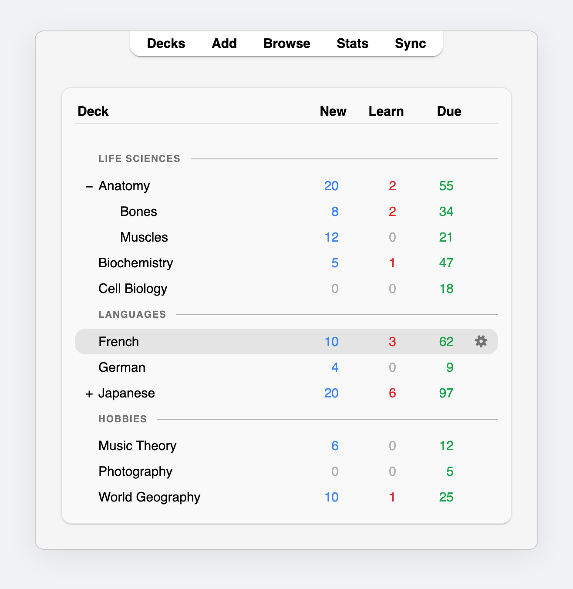
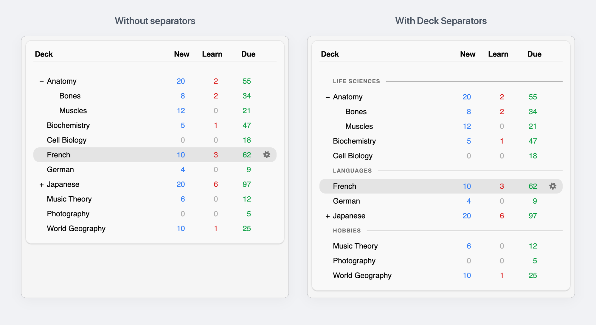
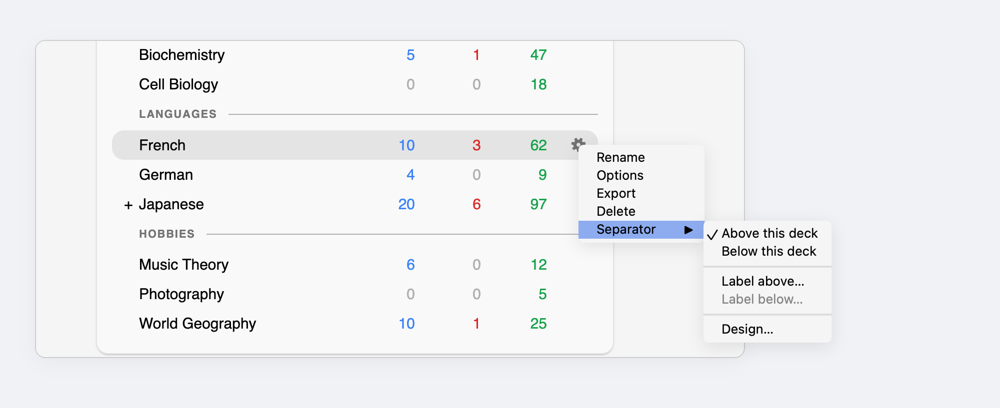
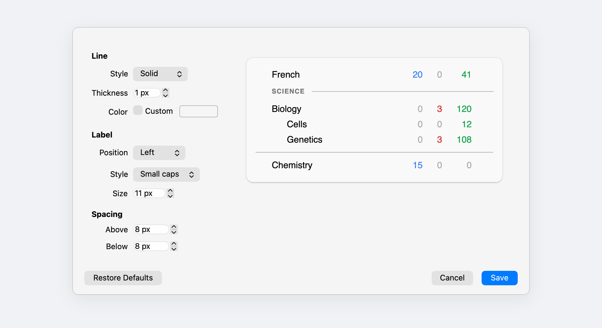
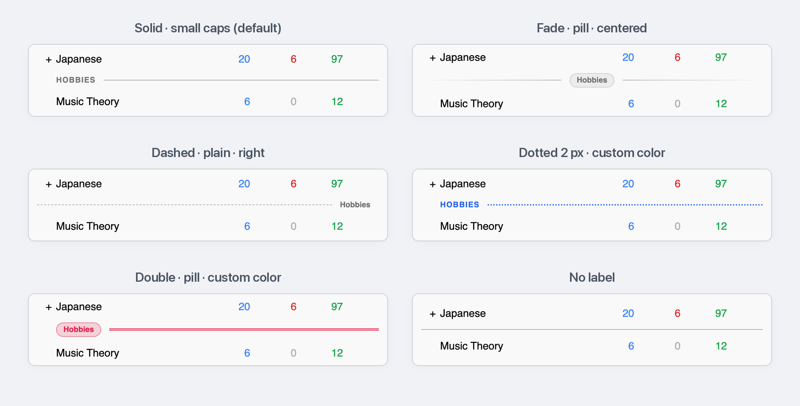
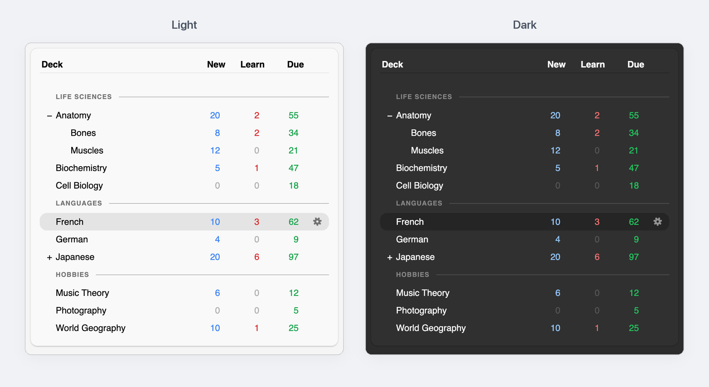

<h1 align="center">Deck Separators</h1>

Organize your Anki deck list into clean, labeled sections.

## Group your decks

## Add one from the gear menu

Click a deck's gear, then **Separator ▸ Above this deck** or **Below this deck**. Labels are optional.

## Make it yours

**Separator ▸ Design…** restyles every separator at once, with a live preview.

## Pick a style

## Light and dark

Separators follow Anki's theme unless you choose a custom color.

## Install

**From [AnkiWeb](https://ankiweb.net/shared/info/2097527231):** in Anki, open **Tools ▸ Add-ons**, click **Get Add-ons...**, paste the code `2097527231` and restart Anki.

**From a file:** download `deck_separators.ankiaddon` from [Releases](../../releases), then in **Tools ▸ Add-ons** click **Install from file...**, pick the file and restart Anki.

Requires Anki 23.10 or newer. The legacy Qt5 builds of Anki are not supported.

## Good to know

- A separator belongs to its deck: it moves when you rename or move the deck, and syncs through AnkiWeb with your collection. AnkiMobile and AnkiDroid don't show separators.
- **Below this deck** places the line after the deck and its open subdecks. A separator inside a collapsed deck is hidden with it.
- The design is saved per computer. Open it from **Separator ▸ Design…** or **Tools ▸ Add-ons ▸ Deck Separators ▸ Config**.

## Contact

Questions or feedback: [mohammad@morad.io](mailto:mohammad@morad.io), or [open an issue](../../issues).
